# DO8_AutomationTools

## Part 1. Удаленное конфигурирование узла через Ansible

1. Создать с помощью Vagrant три машины: manager, node01, node02. Не устанавливать с помощью shell-скриптов docker при создании машин на Vagrant! Прокинуть порты node01 на локальную машину для доступа к пока еще не развернутому микросервисному приложению.


```
# -*- mode: ruby -*-
# vi: set ft=ruby :


Vagrant.configure("2") do |config|
  config.vm.box = "ubuntu/jammy64"
   
  config.vm.define "manager" do |manager|
  
    manager.vm.hostname = "manager"
    manager.vm.network "private_network", ip: "192.168.56.10"
    end
    
  config.vm.define "node01" do |node|
    node.vm.hostname = "node01"
    node.vm.network "private_network", ip: "192.168.56.11"
    
    node.vm.network "forwarded_port", guest: 5432,  host: 15432,  auto_correct: true
    node.vm.network "forwarded_port", guest: 5672,  host: 15672,  auto_correct: true
    node.vm.network "forwarded_port", guest: 15672, host: 25672,  auto_correct: true
    node.vm.network "forwarded_port", guest: 8081,  host: 8081,  auto_correct: true
    node.vm.network "forwarded_port", guest: 8082,  host: 8082,  auto_correct: true
    node.vm.network "forwarded_port", guest: 8083,  host: 8083,  auto_correct: true
    node.vm.network "forwarded_port", guest: 8084,  host: 8084,  auto_correct: true
    node.vm.network "forwarded_port", guest: 8085,  host: 8085,  auto_correct: true
    node.vm.network "forwarded_port", guest: 8086,  host: 8086,  auto_correct: true
    node.vm.network "forwarded_port", guest: 8087,  host: 8087,  auto_correct: true

    end
    
  config.vm.define "node02" do |node|
    node.vm.hostname = "node02"
    node.vm.network "private_network", ip: "192.168.56.12"
    end
end
```
2. Подготовить manager как рабочую станцию для удаленного конфигурирования (помощь по Ansible в материалах).
- Зайти на manager.
- На manager проверить подключение к node01 через ssh по приватной сети.

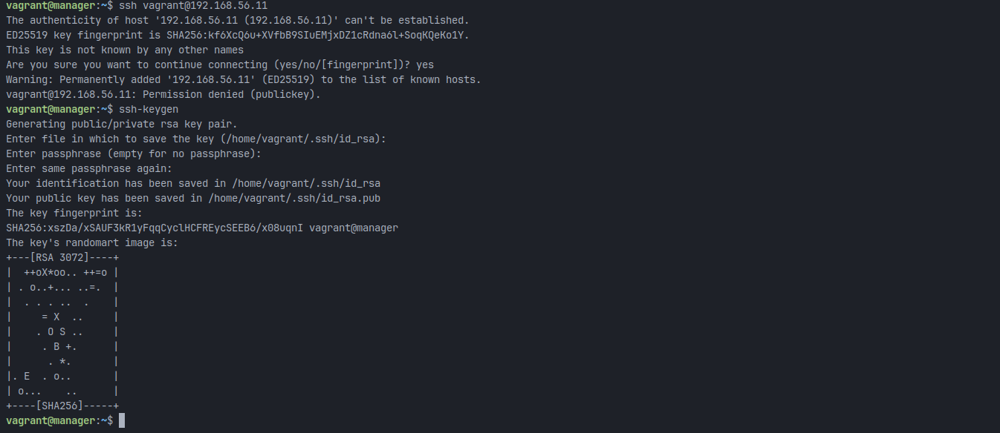

- Сгенерировать ssh-ключ для подключения к node01 из manager (без passphrase).

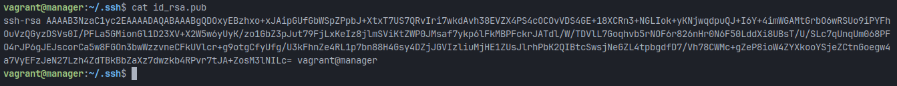
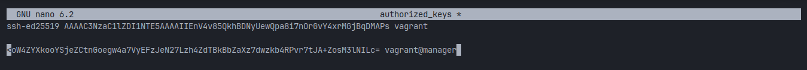
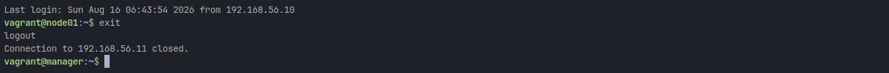
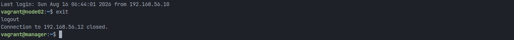

- Скопировать на manager docker-compose файл и исходный код микросервисов. (Используй проект из папки src и - docker-compose файл из предыдущей главы. Помощь по ssh в материалах.)
```
manager.vm.synced_folder "services", "/home/vagrant/services"
```
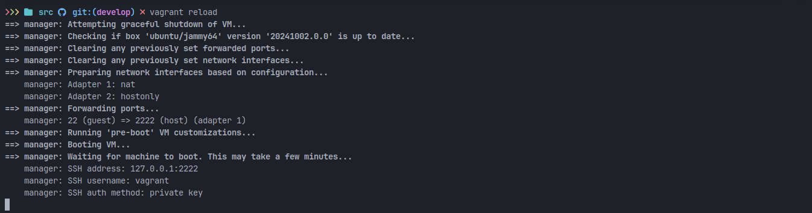

- Установить Ansible на менеджер и создать папку ansible, в которой создать inventory-файл.


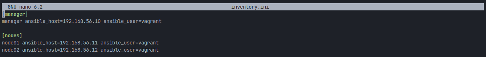

- Использовать модуль ping для проверки подключения через Ansible.
- Результат выполнения модуля поместить в отчет.

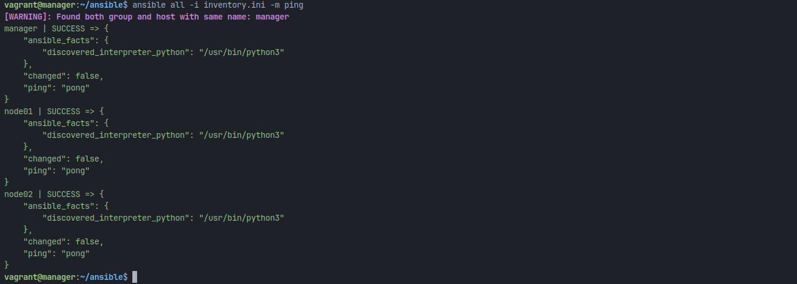

3. Написать первый плейбук для Ansible, который выполняет apt update, устанавливает docker, docker-compose, копирует compose-файл из manager'а и разворачивает микросервисное приложение.
```
---
- name: Install Docker & deploy Swarm
  hosts: all
  become: yes

  tasks:
    - name: Update
      ansible.builtin.apt:
        update_cache: yes
        cache_valid_time: 3600

    - name: Required
      ansible.builtin.apt:
        name:
          - apt-transport-https
          - ca-certificates
          - curl
          - software-properties-common
        state: present

    - name: Add GPG-key Docker
      ansible.builtin.apt_key:
        url: https://download.docker.com/linux/ubuntu/gpg
        state: present

    - name: Add Docker repository
      ansible.builtin.apt_repository:
        repo: deb [arch=amd64] https://download.docker.com/linux/ubuntu jammy stable
        state: present

    - name: Install Docker
      ansible.builtin.apt:
        name:
          - docker-ce
          - docker-ce-cli
          - containerd.io
          - docker-compose-plugin
        state: present
        update_cache: yes

    - name: Start Docker
      ansible.builtin.service:
        name: docker
        state: started
        enabled: yes

    - name: Copy docker-compose.yml
      ansible.builtin.copy:
        src: /home/vagrant/services/docker-compose.yml
        dest: /home/docker-compose.yml
        owner: vagrant
        group: vagrant
        mode: '0644'

    - name: Install pip
      ansible.builtin.apt:
        name: python3-pip
        state: present

    - name: Install Docker SDK
      ansible.builtin.pip:
        name: docker
        executable: pip3

    - name: Pull images
      community.docker.docker_image:
        name: "{{ item }}"
        source: pull
      loop:
        - elanorma/postgres:1.0
        - elanorma/rabbitmq:1.0
        - elanorma/payment-service:1.0
        - elanorma/booking-service:1.0
        - elanorma/gateway-service:1.0
        - elanorma/hotel-service:1.0
        - elanorma/loyalty-service:1.0
        - elanorma/report-service:1.0
        - elanorma/session-service:1.0

    - name: Init Swarm
      ansible.builtin.command: docker swarm init --advertise-addr 192.168.56.10
      when: inventory_hostname == "manager"
      run_once: true
      ignore_errors: yes

    - name: Get token
      command: docker swarm join-token -q worker
      register: worker_token
      when: inventory_hostname == "manager"

    - name: Save token
      set_fact:
        swarm_worker_token: "{{ worker_token.stdout }}"
      when: inventory_hostname == "manager"

    - name: Connect swarm
      ansible.builtin.command: >
        docker swarm join
        --token {{ hostvars['manager'].worker_token.stdout }}
        192.168.56.10:2377
      when: inventory_hostname != "manager"
      ignore_errors: yes

    - name: Deploy
      ansible.builtin.command: docker stack deploy -c /home/vagrant/services/docker-compose.yml app
      when: inventory_hostname == "manager"
```
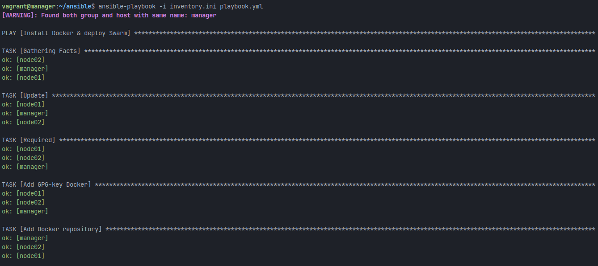
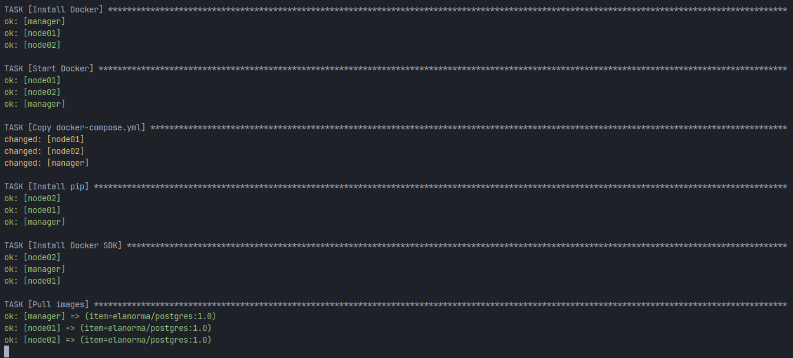
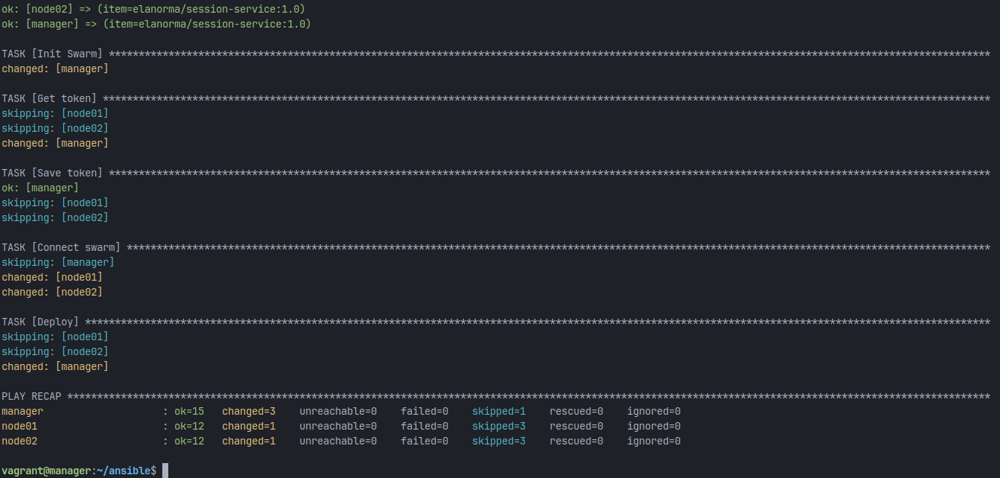
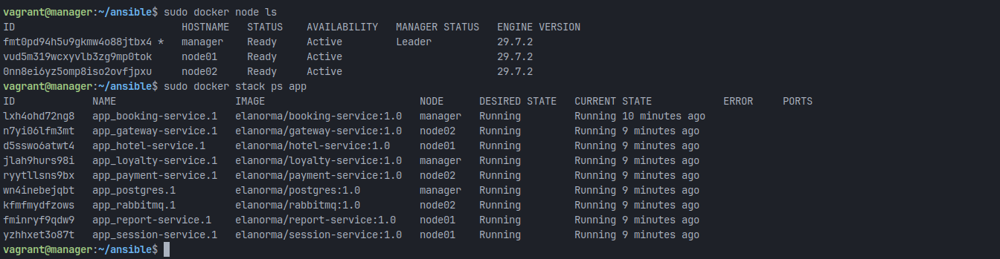

4. Прогнать заготовленные тесты через postman и удостовериться, что все они проходят успешно. В отчете отобразить результаты тестирования.

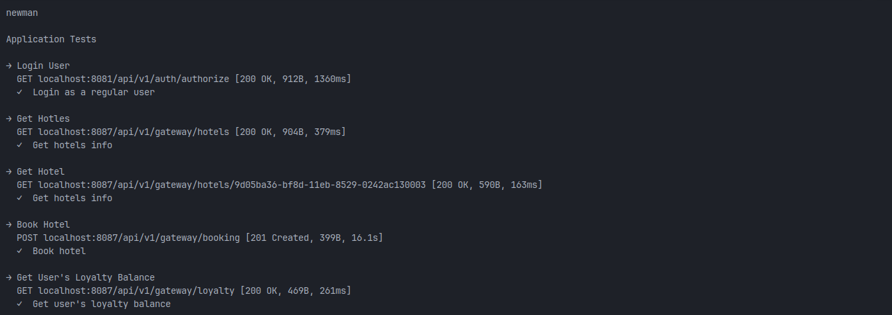
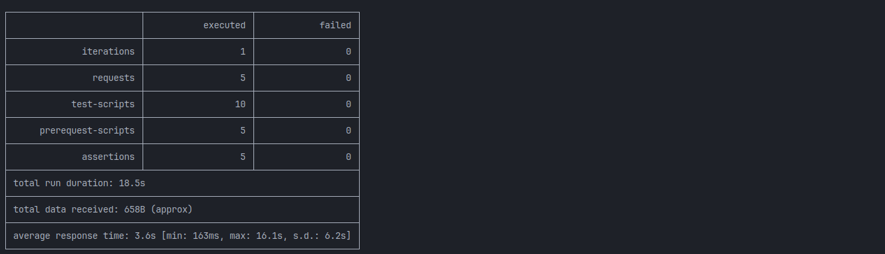

5. Сформировать три роли:

- Роль application выполняет развертывание микросервисного приложения при помощи docker-compose;
```
---
- name: Install dependens
  ansible.builtin.apt:
    name:
      - ca-certificates
      - gnupg
    state: present
    update_cache: yes


- name: Creating directories for keys Docker
  ansible.builtin.file:
    path: /etc/apt/keyrings
    state: directory
    mode: '0755'


- name: Add GPG-key Docker
  ansible.builtin.get_url:
    url: https://download.docker.com/linux/ubuntu/gpg
    dest: /etc/apt/keyrings/docker.asc
    mode: '0644'


- name: Add Docker repository
  ansible.builtin.apt_repository:
    repo: "deb [arch=amd64 signed-by=/etc/apt/keyrings/docker.asc] https://download.docker.com/linux/ubuntu jammy stable"
    state: present
    filename: docker


- name: Install Docker
  ansible.builtin.apt:
    name:
      - docker-ce
      - docker-ce-cli
      - containerd.io
      - docker-compose-plugin
    state: present
    update_cache: yes

- name: Install pip
  ansible.builtin.apt:
    name: python3-pip
    state: present

- name: Install Docker SDK
  ansible.builtin.pip:
    name: docker
    executable: pip3

- name: Started Docker
  ansible.builtin.service:
    name: docker
    state: started
    enabled: yes


- name: Copy docker-compose.yml
  ansible.builtin.copy:
    src: /home/vagrant/services/
    dest: /opt/services
    mode: '0755'

- name: Pull images
  community.docker.docker_image:
    name: "{{ item }}"
    source: pull
  loop:
    - elanorma/postgres:1.0
    - elanorma/rabbitmq:1.0
    - elanorma/payment-service:1.0
    - elanorma/booking-service:1.0
    - elanorma/gateway-service:1.0
    - elanorma/hotel-service:1.0
    - elanorma/loyalty-service:1.0
    - elanorma/report-service:1.0
    - elanorma/session-service:1.0


- name: Deploy
  ansible.builtin.command: docker compose up -d --build
  args:
    chdir: /opt/services
```
- Apache устанавливает и запускает стандартный apache сервер;
```
---
- name: Update apt cache
  apt:
    update_cache: yes

- name: Install Apache2
  apt:
    name: apache2
    state: present

- name: Start and enable Apache service
  systemd:
    name: apache2
    state: started
    enabled: yes

- name: Create custom index.html
  copy:
    content: |
      <!DOCTYPE html>
      <html>
      <head>
          <title>Apache Server</title>
      </head>
      <body>
          <h1>Welcome to Apache Server</h1>
          <p>Server: {{ ansible_hostname }}</p>
          <p>IP: {{ ansible_default_ipv4.address }}</p>
      </body>
      </html>
    dest: /var/www/html/index.html
    owner: www-data
    group: www-data
    mode: '0644'

- name: Ensure Apache is running
  service:
    name: apache2
    state: started
```
- Postgres устанавливает и запускает postgres, создает базу данных с произвольной таблицей и добавляет в нее три произвольные записи.
```
---
- name: Update apt cache
  apt:
    update_cache: yes
    cache_valid_time: 3600

- name: Install PostgreSQL and dependencies
  apt:
    name:
      - postgresql
      - postgresql-contrib
      - python3-psycopg2
      - acl
    state: present

- name: Get PostgreSQL version
  shell: psql --version | awk '{print $3}' | cut -d. -f1
  register: pg_version
  changed_when: false

- name: Set PostgreSQL version fact
  set_fact:
    postgresql_version: "{{ pg_version.stdout }}"

- name: Start and enable PostgreSQL service
  systemd:
    name: postgresql
    state: started
    enabled: yes

- name: Wait for PostgreSQL to start
  wait_for:
    port: 5432
    timeout: 30

- name: Create database and user
  shell: |
    psql -v ON_ERROR_STOP=1 --username postgres <<-EOSQL
      DO \$\$
      BEGIN
        IF NOT EXISTS (SELECT FROM pg_user WHERE usename = 'devops_user') THEN
          CREATE USER devops_user WITH PASSWORD 'devops_password';
        END IF;
      END
      \$\$;
      
      SELECT 'CREATE DATABASE devops_db OWNER devops_user'
      WHERE NOT EXISTS (SELECT FROM pg_database WHERE datname = 'devops_db')\gexec
      
      GRANT ALL PRIVILEGES ON DATABASE devops_db TO devops_user;
    EOSQL
  become: yes
  become_user: postgres
  register: db_create
  changed_when: "'CREATE DATABASE' in db_create.stdout or 'CREATE USER' in db_create.stdout"

- name: Create table
  shell: |
    psql -v ON_ERROR_STOP=1 -d devops_db <<-EOSQL
      CREATE TABLE IF NOT EXISTS example_data (
        id SERIAL PRIMARY KEY,
        name VARCHAR(100),
        description TEXT,
        created_at TIMESTAMP DEFAULT CURRENT_TIMESTAMP
      );
      GRANT ALL PRIVILEGES ON ALL TABLES IN SCHEMA public TO devops_user;
      GRANT USAGE, SELECT ON ALL SEQUENCES IN SCHEMA public TO devops_user;
    EOSQL
  become: yes
  become_user: postgres
  register: table_create
  changed_when: "'CREATE TABLE' in table_create.stdout"

- name: Insert data
  shell: |
    psql -v ON_ERROR_STOP=1 -d devops_db <<-EOSQL
      INSERT INTO example_data (name, description) VALUES
        ('Example 1', 'First example'),
        ('Example 2', 'Second example'),
        ('Example 3', 'Third example')
      ON CONFLICT (id) DO NOTHING;
    EOSQL
  become: yes
  become_user: postgres
  register: data_insert
  changed_when: "'INSERT 0' in data_insert.stdout"

- name: Get PostgreSQL config directory
  find:
    paths: /etc/postgresql
    file_type: directory
    patterns: "{{ postgresql_version }}.*"
    use_regex: yes
  register: pg_config_dir

- name: Set PostgreSQL config path
  set_fact:
    pg_config_path: "{{ pg_config_dir.files[0].path }}"
  when: pg_config_dir.files | length > 0

- name: Configure PostgreSQL to accept connections
  lineinfile:
    path: "{{ pg_config_path }}/main/postgresql.conf"
    regexp: '^#?listen_addresses'
    line: "listen_addresses = '*'"
    backup: yes
  notify: restart postgresql
  when: pg_config_path is defined

- name: Configure PostgreSQL authentication
  lineinfile:
    path: "{{ pg_config_path }}/main/pg_hba.conf"
    line: "host    all             all             0.0.0.0/0               md5"
    insertafter: '^# IPv4 local connections:'
    backup: yes
  notify: restart postgresql
  when: pg_config_path is defined

- name: Open PostgreSQL port in firewall
  ufw:
    rule: allow
    port: '5432'
    proto: tcp
  when: ansible_facts['os_family'] == "Debian"
  ignore_errors: yes

- name: Verify database content
  shell: |
    psql -d devops_db -c "SELECT * FROM example_data;"
  become: yes
  become_user: postgres
  register: verify_data
  changed_when: false

- name: Display database content
  debug:
    var: verify_data.stdout_lines

- name: Display connection info
  debug:
    msg: |
      PostgreSQL is ready!
      Connection string: psql -h {{ ansible_default_ipv4.address }} -U devops_user -d devops_db -W
      Password: devops_password
```
- Назначить первую роль node01 и вторые две роли node02
```
---
- name: Deploy application on node01
  hosts: application
  become: yes
  roles:
    - application

- name: Setup Apache and PostgreSQL on node02
  hosts: node02
  become: yes
  roles:
    - apache
    - postgres
```

- проверить postman-тестами работоспособность микросервисного приложения

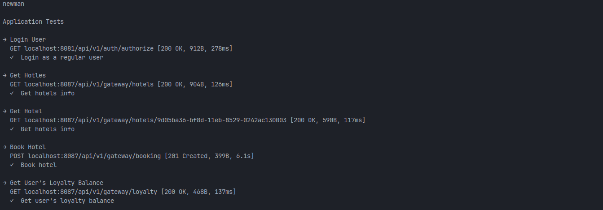
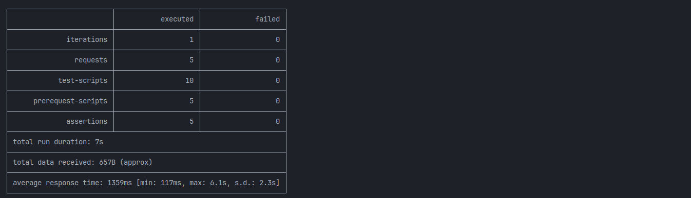

- удостовериться в доступности postgres и apache-сервера. Для Apache веб-страница должна открыться в браузере

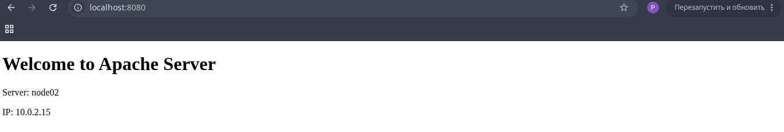

- что касается PostgreSQL, необходимо подключиться с локальной машины и отобразить содержимое ранее созданной таблицы с данными

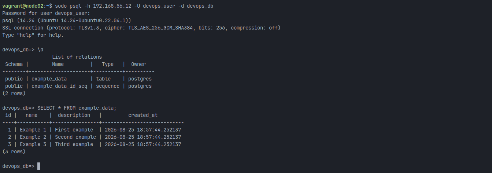

