# SimpleDocker

## Part 1

- Скачивание образа nginx с Docker Hub.
```
docker pull nginx
```
- Проверка списка образов на локальном хосте.
```
docker images
```

- Первый запуск контейнера.
```
docker run -d nginx
```

- Проверка работающих контейнеров.
```
docker ps
```
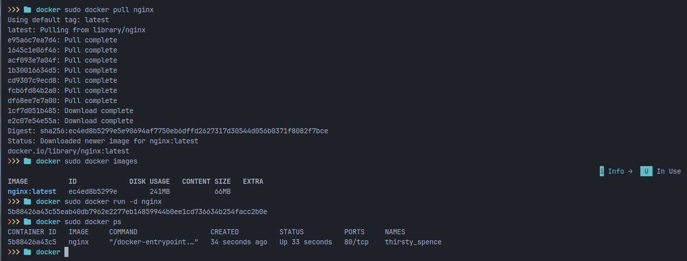

- Смотрим информацию о контейнере
```
docker inspect 5b88426a43c5
```
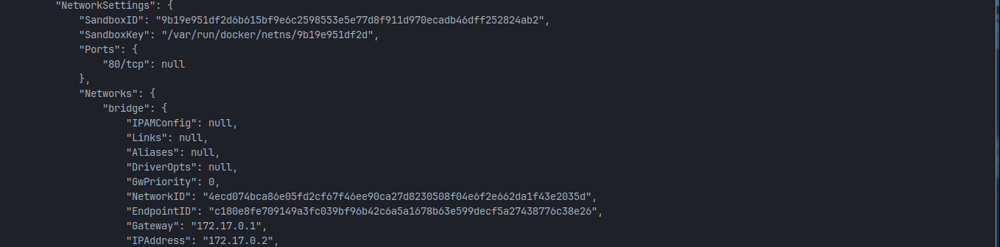


- В выводе docker inspect размер контейнера не представлен, поэтому для получения этой информации использована команда 
```
docker ps -s
```
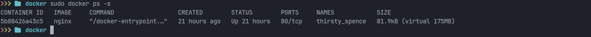

- Останавливаем докер-контейнер через 
```
docker stop 5b88426a43c5
```
- Проверяем, что контейнер остановился через 
```
docker ps
```
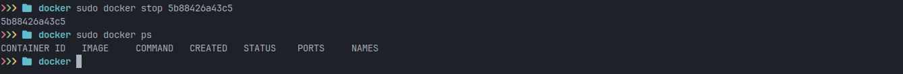

- Запускаем докер с портами 80 и 443 в контейнере, замапленными на такие же порты на локальной машине, через команду run
```
docker run -d -p 80:80 -p 443:443 nginx
```
- Проверяем, что в браузере по адресу localhost:80 доступна стартовая страница nginx.
- Перезапускаем докер-контейнер через 
```
docker restart 6d08f0adba96
```
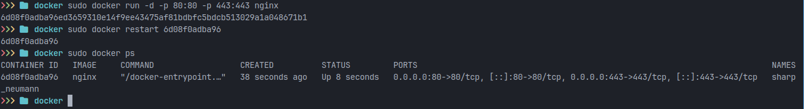
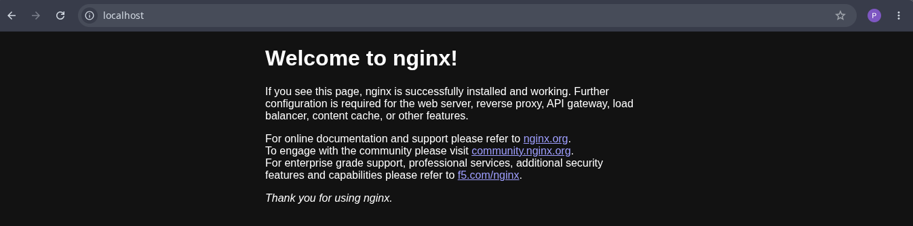

## Part 2

- Открываем конфигурационный файл nginx.conf внутри докер контейнера через команду exec.
```
docker exec 6d08f0adba96 cat /etc/nginx/nginx.conf
```
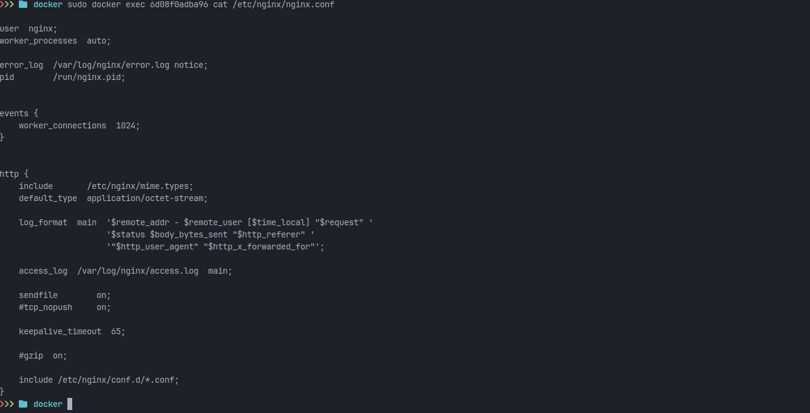

- Создаем на локальной машине файл nginx.conf.
- Настраиваем в нем по пути /status отдачу страницы статуса сервера nginx.

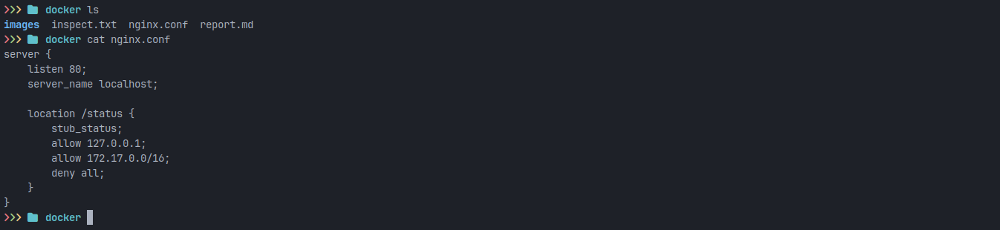

- Копируем созданный файл nginx.conf внутрь докер-контейнера через команду
```
docker cp nginx.conf 6d08f0adba96:/etc/nginx/conf.d/default.conf
```
- Перезапускаем nginx внутри докер-контейнера через команду exec.
```
docker exec 6d08f0adba96 nginx -s reload
```
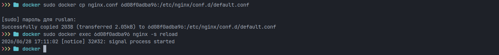

- Проверяем, что по адресу localhost:80/status отдается страничка со статусом сервера nginx.

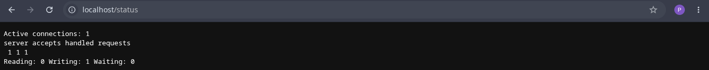

- Экспортируем контейнер в файл container.tar через команду export.
```
docker export 6d08f0adba96 > container.tar
```
- Останавливаем контейнер.

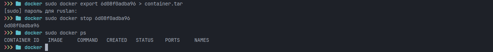

- Удаляем образ через docker rmi, не удаляя перед этим контейнеры.
```
docker rmi -f ec4ed8b5299e
```
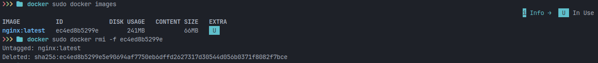

- Удаляем остановленный контейнер.
```
docker rm 6d08f0adba96 ffb19e5d0cdd 7ecb471f61be
```
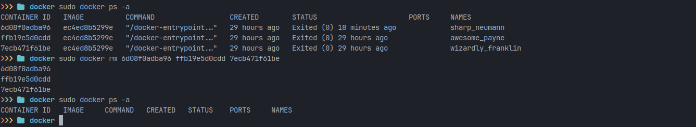

- Создаём образ из файла container.tar через команду import.
```
docker import container.tar my-nginx:new_image
```
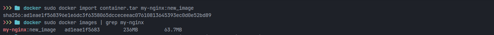

- Создаём и запускаем контейнер на основе импортированного образа.
```
docker run -d -p 80:80 -p 443:443 --name my-nginx-container my-nginx:new_image nginx -g "daemon off;"
```
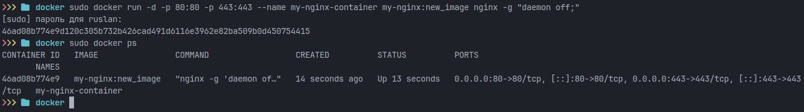

- Проверяем, что по адресу localhost:80/status отдается страничка со статусом сервера nginx.

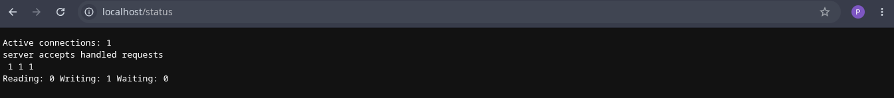

## Part 3

- Пишем мини-сервер на C и FastCgi, который будет возвращать простейшую страничку с надписью Hello, World!.

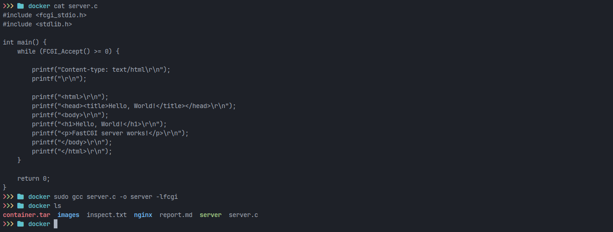

- Запускаем написанный мини-сервер через spawn-fcgi на порту 8080.
```
spawn-fcgi -p 8080 -d . ./server
```
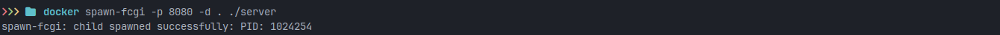

- Пишем свой nginx.conf, который будет проксировать все запросы с 81 порта на 127.0.0.1:8080.

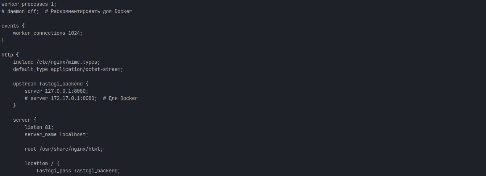

- Запускаем локально nginx с написанной конфигурацией.
```
sudo nginx -c /home/ruslan/docker/nginx/nginx.conf
```
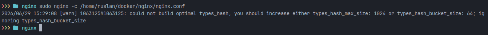

- Проверяем, что в браузере по localhost:81 отдается написанная мной страничка.

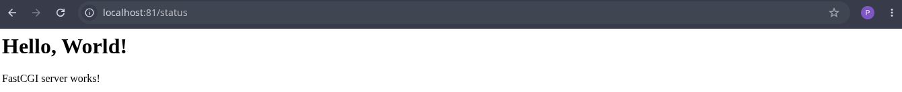

## Part 4

- Пишем свой докер-образ, который:
1) собирает исходники мини сервера на FastCgi из Части 3;
2) запускает его на 8080 порту;
3) копирует внутрь образа написанный ./nginx/nginx.conf;
4) запускает nginx.

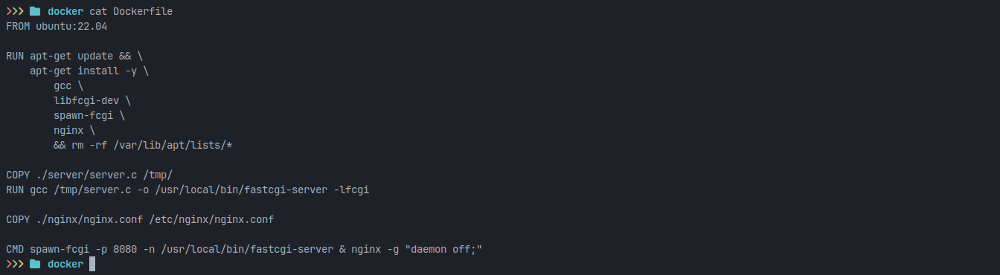

- Собираем написанный докер-образ через docker build при этом указав имя и тег.
```
docker build -t fastcgi-app:latest .
```
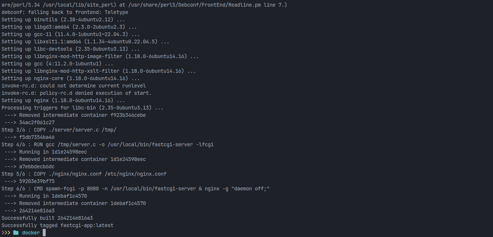

- Проверяем через docker images, что все собралось корректно.

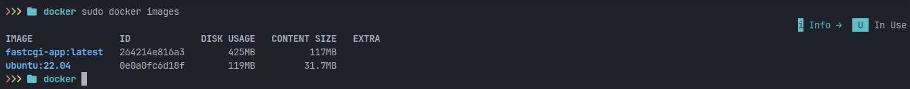

- Запускаем собранный докер-образ с маппингом 81 порта на 80 на локальной машине и маппингом папки ./nginx внутрь контейнера по адресу, где лежат конфигурационные файлы nginx'а (см. Часть 2).

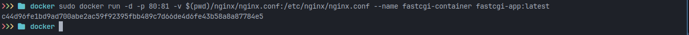

- Проверяем, что по localhost:80 доступна страничка написанного мини сервера.

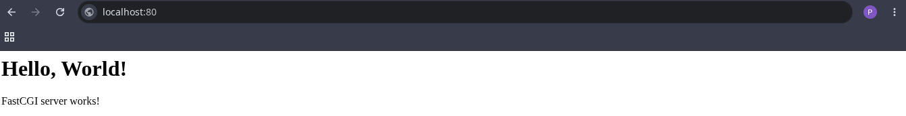

- Дописываем в ./nginx/nginx.conf проксирование странички /status, по которой надо отдавать статус сервера nginx.

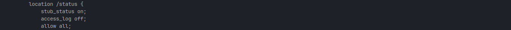

- Перезапускаем контейнер.

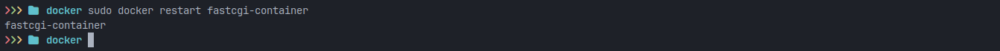

- Проверяем, что теперь по localhost:80/status отдается страничка со статусом nginx.

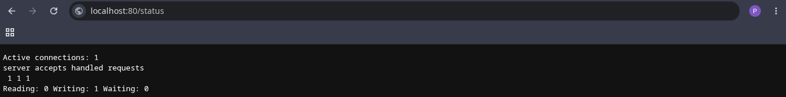

## Part 5

- Сканируем образ из предыдущего задания через dockle.

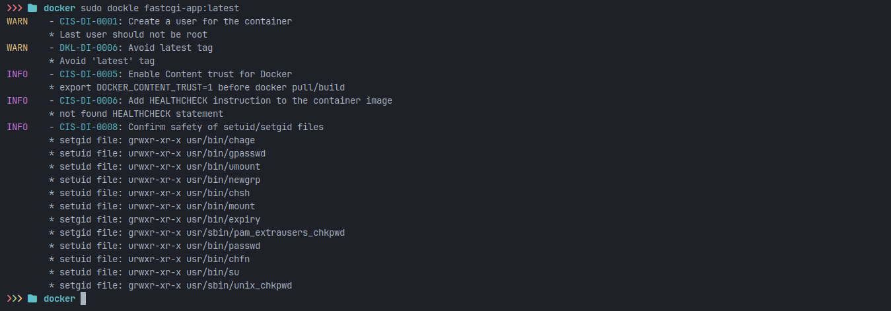

- Исправляем образ так, чтобы при проверке через dockle не было ошибок и предупреждений.

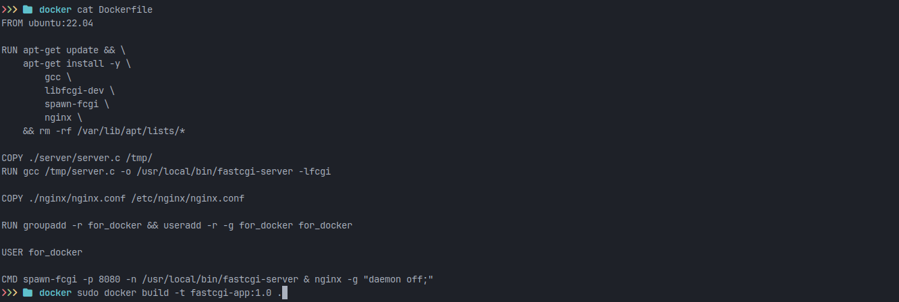
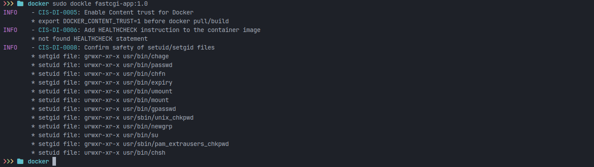

## Part 6

- Пишем файл docker-compose.yml, с помощью которого:
1) Поднимаем докер-контейнер из Части 5 (он должен работать в локальной сети, т. е. не нужно использовать инструкцию EXPOSE и мапить порты на локальную машину).

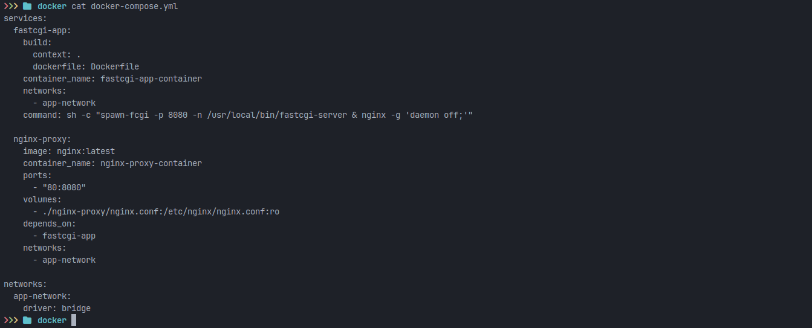

2) Поднимаем докер-контейнер с nginx, который будет проксировать все запросы с 8080 порта на 81 порт первого контейнера.

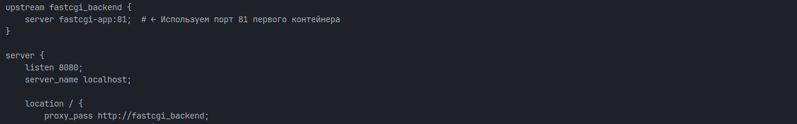

- Замапили 8080 порт второго контейнера на 80 порт локальной машины.

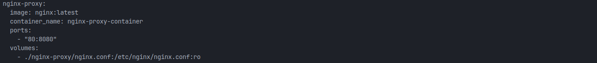

- Останавливаем все запущенные контейнеры.

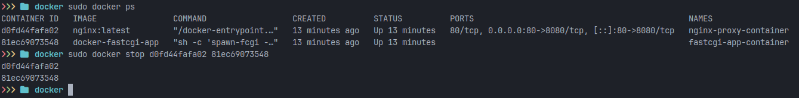

- Сборка и запуск проекта с помощью команд 
```
docker compose build

docker compose up -d
```
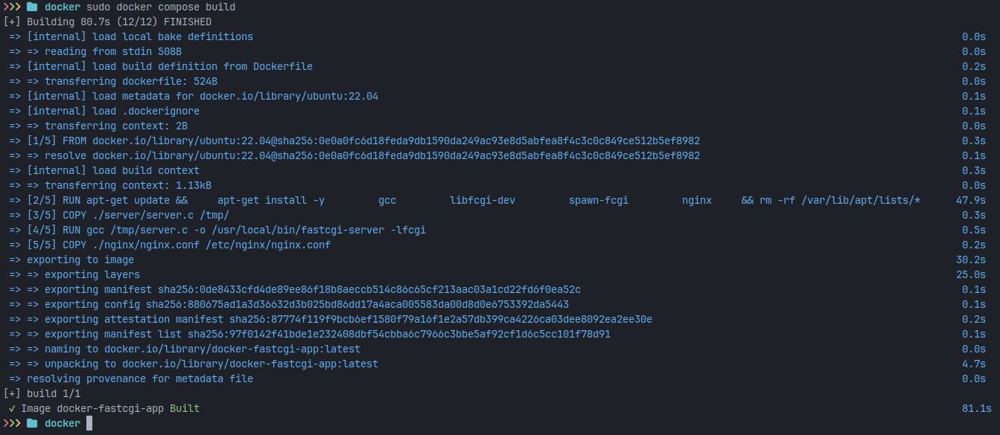
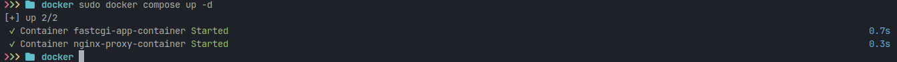

- Проверяем, что в браузере по localhost:80 отдается написанная страничка, как и ранее.

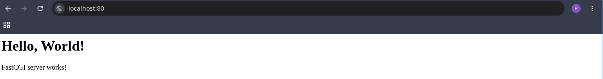

##