# DO7_Docker_Compose

## Part 1. Запуск нескольких Docker-контейнеров с использованием Docker Compose

- Напиши Dockerfile для каждого отдельного микросервиса. Необходимые зависимости описаны в материалах. В отчете отобрази размер собранных образов любого сервиса различными способами.

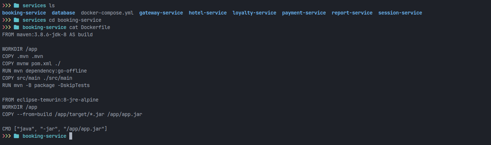
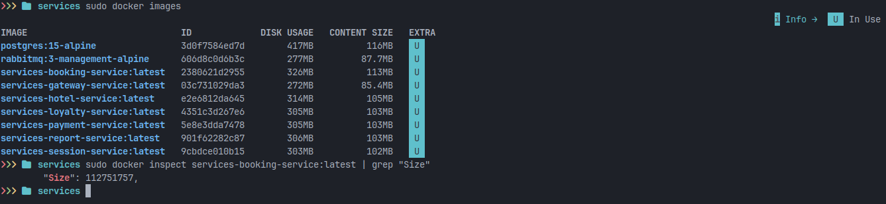

- Напиши Docker Compose файл, который осуществляет корректное взаимодействие сервисов. Пробрось порты для доступа к gateway service и session service из локальной машины. Помощь по Docker Compose ты найдешь в материалах.
```
version: '3.8'

services:
  postgres:
    image: postgres:15-alpine
    container_name: postgres
    environment:
      POSTGRES_USER: postgres
      POSTGRES_PASSWORD: postgres
    volumes:
      - ./database/init.sql:/docker-entrypoint-initdb.d/init.sql
      - postgres_data:/var/lib/postgresql/data
    ports:
      - "5432:5432"
    networks:
      - app-network
    healthcheck:
      test: ["CMD-SHELL", "pg_isready -U postgres"]
      interval: 10s
      timeout: 5s
      retries: 5

  rabbitmq:
    image: rabbitmq:3-management-alpine
    container_name: rabbitmq
    environment:
      RABBITMQ_DEFAULT_USER: guest
      RABBITMQ_DEFAULT_PASS: guest
    ports:
      - "5672:5672"
      - "15672:15672"
    networks:
      - app-network
    healthcheck:
      test: ["CMD", "rabbitmq-diagnostics", "-q", "ping"]
      interval: 10s
      timeout: 5s
      retries: 5

  session-service:
    build:
      context: ./session-service
      dockerfile: Dockerfile
    container_name: session-service
    environment:
      SPRING_DATASOURCE_URL: jdbc:postgresql://postgres:5432/users_db
      SPRING_DATASOURCE_USERNAME: postgres
      SPRING_DATASOURCE_PASSWORD: postgres
      SPRING_JPA_HIBERNATE_DDL_AUTO: update
      SPRING_JPA_PROPERTIES_HIBERNATE_DIALECT: org.hibernate.dialect.PostgreSQLDialect
    ports:
      - "8081:8081"
    networks:
      - app-network
    depends_on:
      postgres:
        condition: service_healthy

  hotel-service:
    build:
      context: ./hotel-service
      dockerfile: Dockerfile
    container_name: hotel-service
    environment:
      SPRING_DATASOURCE_URL: jdbc:postgresql://postgres:5432/hotels_db
      SPRING_DATASOURCE_USERNAME: postgres
      SPRING_DATASOURCE_PASSWORD: postgres
      SPRING_JPA_HIBERNATE_DDL_AUTO: update
      SPRING_JPA_PROPERTIES_HIBERNATE_DIALECT: org.hibernate.dialect.PostgreSQLDialect
    ports:
      - "8082:8082"
    networks:
      - app-network
    depends_on:
      postgres:
        condition: service_healthy

  payment-service:
    build:
      context: ./payment-service
      dockerfile: Dockerfile
    container_name: payment-service
    environment:
      SPRING_DATASOURCE_URL: jdbc:postgresql://postgres:5432/payments_db
      SPRING_DATASOURCE_USERNAME: postgres
      SPRING_DATASOURCE_PASSWORD: postgres
      SPRING_JPA_HIBERNATE_DDL_AUTO: update
      SPRING_JPA_PROPERTIES_HIBERNATE_DIALECT: org.hibernate.dialect.PostgreSQLDialect
    ports:
      - "8084:8084"
    networks:
      - app-network
    depends_on:
      postgres:
        condition: service_healthy

  loyalty-service:
    build:
      context: ./loyalty-service
      dockerfile: Dockerfile
    container_name: loyalty-service
    environment:
      SPRING_DATASOURCE_URL: jdbc:postgresql://postgres:5432/balances_db
      SPRING_DATASOURCE_USERNAME: postgres
      SPRING_DATASOURCE_PASSWORD: postgres
      SPRING_JPA_HIBERNATE_DDL_AUTO: update
      SPRING_JPA_PROPERTIES_HIBERNATE_DIALECT: org.hibernate.dialect.PostgreSQLDialect
    ports:
      - "8085:8085"
    networks:
      - app-network
    depends_on:
      postgres:
        condition: service_healthy

  report-service:
    build:
      context: ./report-service
      dockerfile: Dockerfile
    container_name: report-service
    environment:
      SPRING_DATASOURCE_URL: jdbc:postgresql://postgres:5432/statistics_db
      SPRING_DATASOURCE_USERNAME: postgres
      SPRING_DATASOURCE_PASSWORD: postgres
      SPRING_JPA_HIBERNATE_DDL_AUTO: update
      SPRING_JPA_PROPERTIES_HIBERNATE_DIALECT: org.hibernate.dialect.PostgreSQLDialect
      RABBIT_MQ_HOST: rabbitmq
      RABBIT_MQ_PORT: 5672
      RABBIT_MQ_USER: guest
      RABBIT_MQ_PASSWORD: guest
      RABBIT_MQ_QUEUE_NAME: messagequeue
      RABBIT_MQ_EXCHANGE: messagequeue-exchange
    ports:
      - "8086:8086"
    networks:
      - app-network
    depends_on:
      postgres:
        condition: service_healthy
      rabbitmq:
        condition: service_healthy

  booking-service:
    build:
      context: ./booking-service
      dockerfile: Dockerfile
    container_name: booking-service
    environment:
      SPRING_DATASOURCE_URL: jdbc:postgresql://postgres:5432/reservations_db
      SPRING_DATASOURCE_USERNAME: postgres
      SPRING_DATASOURCE_PASSWORD: postgres
      SPRING_JPA_HIBERNATE_DDL_AUTO: update
      SPRING_JPA_PROPERTIES_HIBERNATE_DIALECT: org.hibernate.dialect.PostgreSQLDialect
      RABBIT_MQ_HOST: rabbitmq
      RABBIT_MQ_PORT: 5672
      RABBIT_MQ_USER: guest
      RABBIT_MQ_PASSWORD: guest
      RABBIT_MQ_QUEUE_NAME: messagequeue
      RABBIT_MQ_EXCHANGE: messagequeue-exchange
      HOTEL_SERVICE_HOST: hotel-service
      HOTEL_SERVICE_PORT: 8082
      PAYMENT_SERVICE_HOST: payment-service
      PAYMENT_SERVICE_PORT: 8084
      LOYALTY_SERVICE_HOST: loyalty-service
      LOYALTY_SERVICE_PORT: 8085
    ports:
      - "8083:8083"
    networks:
      - app-network
    depends_on:
      postgres:
        condition: service_healthy
      rabbitmq:
        condition: service_healthy
      hotel-service:
        condition: service_started
      payment-service:
        condition: service_started
      loyalty-service:
        condition: service_started

  gateway-service:
    build:
      context: ./gateway-service
      dockerfile: Dockerfile
    container_name: gateway-service
    environment:
      SESSION_SERVICE_HOST: session-service
      SESSION_SERVICE_PORT: 8081
      HOTEL_SERVICE_HOST: hotel-service
      HOTEL_SERVICE_PORT: 8082
      BOOKING_SERVICE_HOST: booking-service
      BOOKING_SERVICE_PORT: 8083
      PAYMENT_SERVICE_HOST: payment-service
      PAYMENT_SERVICE_PORT: 8084
      LOYALTY_SERVICE_HOST: loyalty-service
      LOYALTY_SERVICE_PORT: 8085
      REPORT_SERVICE_HOST: report-service
      REPORT_SERVICE_PORT: 8086
    ports:
      - "8087:8087"
    networks:
      - app-network
    depends_on:
      - session-service
      - hotel-service
      - booking-service
      - payment-service
      - loyalty-service
      - report-service

networks:
  app-network:
    driver: bridge

volumes:
  postgres_data:
```

- Собери и разверни веб-сервис с помощью написанного Docker Compose файла на локальной машине.

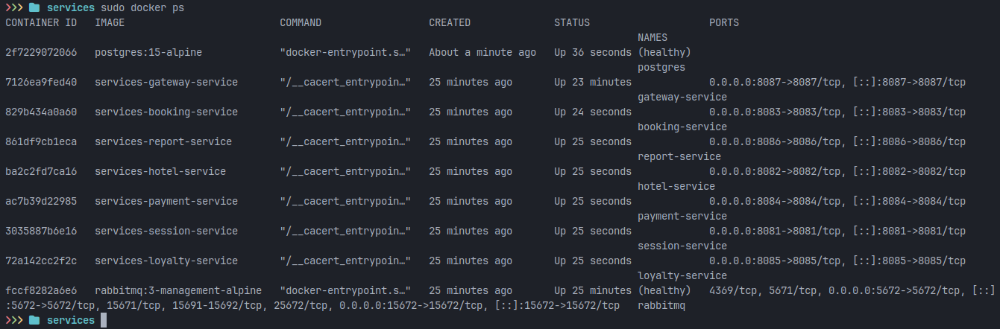

- Прогони заготовленные тесты через postman и удостоверься, что все они проходят успешно. Инструкцию по запуску тестов можно найти в материалах. В отчете отобрази результаты тестирования.


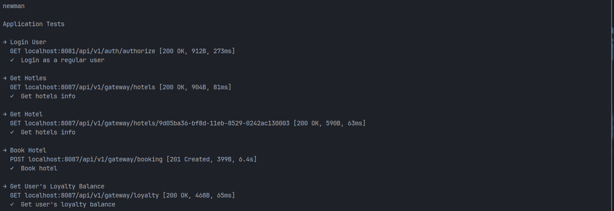
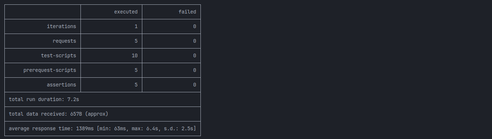

## Part 2. Создание виртуальных машин

- Установи и инициализируй Vagrant в корне проекта. Напиши Vagrantfile для одной виртуальной машины. Перенеси исходный код веб-сервиса в рабочую директорию виртуальной машины.

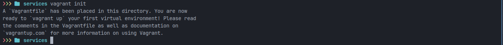
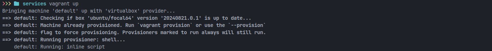
```
# -*- mode: ruby -*-
# vi: set ft=ruby :

Vagrant.configure("2") do |config|
  # Используем базовый образ Ubuntu 20.04 LTS
  config.vm.box = "ubuntu/focal64"
  
  # Настройка имени виртуальной машины
  config.vm.hostname = "microservices-dev"
  
  # Настройка сети - проброс портов для доступа к сервисам
  config.vm.network "forwarded_port", guest: 8081, host: 8081  # session-service
  config.vm.network "forwarded_port", guest: 8082, host: 8082  # hotel-service
  config.vm.network "forwarded_port", guest: 8083, host: 8083  # booking-service
  config.vm.network "forwarded_port", guest: 8084, host: 8084  # payment-service
  config.vm.network "forwarded_port", guest: 8085, host: 8085  # loyalty-service
  config.vm.network "forwarded_port", guest: 8086, host: 8086  # report-service
  config.vm.network "forwarded_port", guest: 8087, host: 8087  # gateway-service
  config.vm.network "forwarded_port", guest: 5432, host: 5432  # PostgreSQL
  config.vm.network "forwarded_port", guest: 5672, host: 5672  # RabbitMQ
  config.vm.network "forwarded_port", guest: 15672, host: 15672 # RabbitMQ Management
  
  # Настройка ресурсов виртуальной машины
  config.vm.provider "virtualbox" do |vb|
    vb.name = "microservices-dev"
    vb.memory = 4096
    vb.cpus = 2
  end
  
  # Синхронизация папок - монтируем весь проект в /app внутри ВМ
  config.vm.synced_folder ".", "/app", type: "rsync",
    rsync__exclude: [".git/", ".vagrant/", "node_modules/", "*.log"]
  
  # Shell-скрипт для установки Docker и необходимых инструментов
  config.vm.provision "shell", inline: <<-SHELL
    echo "Обновление системы..."
    apt-get update -y
    apt-get upgrade -y
    
    echo "Установка Docker..."
    apt-get install -y apt-transport-https ca-certificates curl software-properties-common
    curl -fsSL https://download.docker.com/linux/ubuntu/gpg | apt-key add -
    add-apt-repository "deb [arch=amd64] https://download.docker.com/linux/ubuntu $(lsb_release -cs) stable"
    apt-get update -y
    apt-get install -y docker-ce docker-ce-cli containerd.io
    usermod -aG docker vagrant
    
    echo "Установка Docker Compose..."
    curl -L "https://github.com/docker/compose/releases/download/v2.24.0/docker-compose-$(uname -s)-$(uname -m)" -o /usr/local/bin/docker-compose
    chmod +x /usr/local/bin/docker-compose
    
    echo "Установка дополнительных утилит..."
    apt-get install -y net-tools htop git jq curl wget
    
    echo "Подготовка завершена!"
    echo "Исходный код доступен в /app"
    echo "Проверьте: ls -la /app/"
    
    # Проверка Docker
    docker --version
    docker-compose --version
  SHELL
  
  # Дополнительная настройка для быстрого запуска
  config.vm.provision "shell", run: "always", inline: <<-SHELL
    echo "Виртуальная машина готова к работе!"
    echo "Код проекта: /app"
    echo "Порты проброшены: 8081-8087, 5432, 5672, 15672"
    echo "Для входа: vagrant ssh"
  SHELL
end
```

- Зайди через консоль внутрь виртуальной машины и удостоверься, что исходный код встал, куда нужно. Останови и уничтожь виртуальную машину.

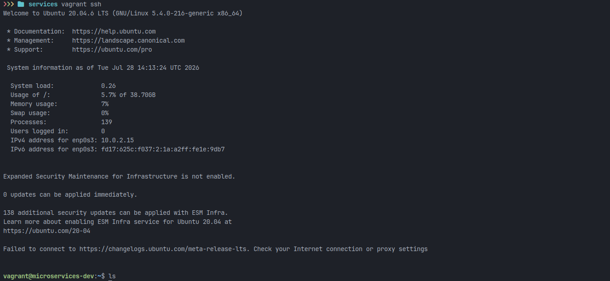
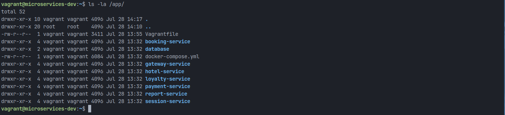
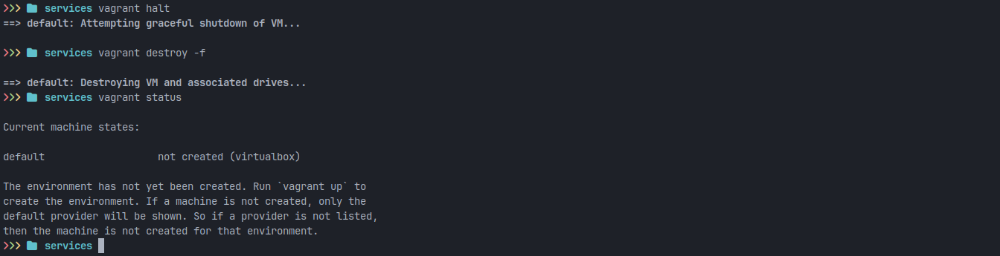

## Part 3. Создание простейшего Docker Swarm

- Модифицируй Vagrantfile для создания трех машин: manager01, worker01, worker02. Напиши shell-скрипты для установки Docker внутрь машин, инициализации и подключения к Docker Swarm.
```
# -*- mode: ruby -*-
# vi: set ft=ruby :


Vagrant.configure("2") do |config|
  config.vm.box = "ubuntu/jammy64"
  
  
  config.vm.provision "shell", inline: <<-SHELL
    while [ ! -d /vagrant/scripts ]; do
      sleep 1
    done
    
    chmod +x /vagrant/scripts/*
    /vagrant/scripts/base_script.sh
  SHELL
  
  config.vm.define "manager01" do |manager|
    manager.vm.hostname = "manager01"
  
    manager.vm.network "private_network", ip: "192.168.56.10"
    manager.vm.network "forwarded_port", guest: 8081, host: 8081, auto_correct: true
    manager.vm.network "forwarded_port", guest: 8087, host: 8087, auto_correct: true
    manager.vm.network "forwarded_port", guest: 9000, host: 9001, auto_correct: true
    

    end
  
  config.vm.define "worker01" do |worker|
    worker.vm.hostname = "worker01"
    worker.vm.network "private_network", ip: "192.168.56.11"
    end
    
  config.vm.define "worker02" do |worker|
    worker.vm.hostname = "worker02"
    worker.vm.network "private_network", ip: "192.168.56.12"
    end

end

```
```
#!/bin/bash

apt-get update
    apt-get install -y curl firewalld nginx
    curl -fsSL https://get.docker.com | sh
    apt-get install -y docker-compose-plugin
    usermod -aG docker vagrant
    
    systemctl enable firewalld
    systemctl start firewalld
    systemctl start nginx
    
    if ! swapon --show | grep -q '/swapfile'; then
      fallocate -l 1G /swapfile
      chmod 600 /swapfile
      mkswap /swapfile
      swapon /swapfile
      echo '/swapfile none swap sw 0 0' >> /etc/fstab
    fi
    
    case "$HOSTNAME" in
      manager01)
        /vagrant/scripts/manager_ports.sh
        /vagrant/scripts/manager_swarm.sh
        ;;
      worker*)
        /vagrant/scripts/worker_ports.sh
        /vagrant/scripts/token.sh
        ;;
    esac
    
    if [ "$HOSTNAME" = "manager01" ]; then
      /vagrant/scripts/manager_deploy.sh
    fi

```
- Загрузи собранные образы на Docker Hub и модифицируй Docker Compose файл для подгрузки расположенных на Docker Hub образов.

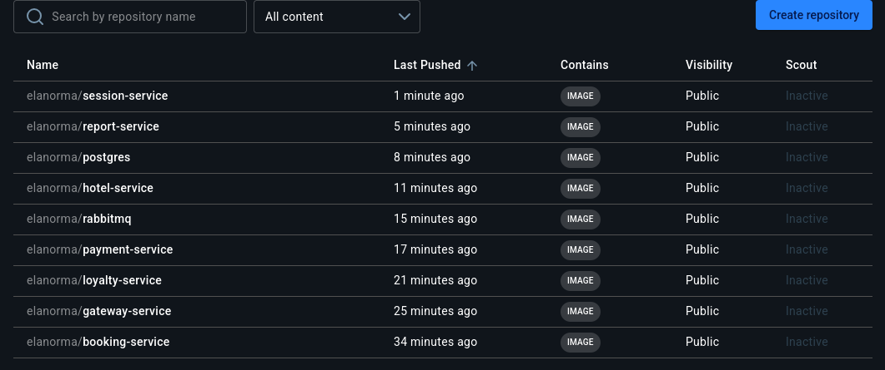

- Подними виртуальные машины и перенеси на менеджер Docker Compose файл. Запусти стек сервисов, используя написанный Docker Compose файл.

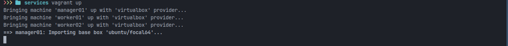
```
networks:
  app_default:
    external: false

configs:
  nginx_conf:
    external: true

services:
  nginx:
    image: nginx:latest
    ports:
      - "8081:80"
      - "8087:81"
    networks:
      - app_default
    configs:
      - source: nginx_conf
        target: /etc/nginx/conf.d/default.conf
    deploy:
      placement:
        constraints:
          - node.hostname == manager01

  postgres:
    image: elanorma/postgres:1.0
    ports:
      - "5432:5432"
    environment:
      TZ: "Europe/Moscow"
      POSTGRES_USER: postgres
      POSTGRES_PASSWORD: postgres
      POSTGRES_DB: app
    networks:
      - app_default
    volumes:
      - app:/var/lib/postgresql/data
    deploy:
      placement:
        constraints:
          - node.hostname == manager01

  rabbitmq:
    image: elanorma/rabbitmq:1.0
    ports:
      - "15672:15672"
      - "5672:5672"
    environment:
      TZ: "Europe/Moscow"
    networks:
      - app_default
    deploy:
      placement:
        constraints:
          - node.hostname == manager01

  session-service:
    image: elanorma/session-service:1.0
    environment:
      POSTGRES_HOST: postgres
      POSTGRES_PORT: 5432
      POSTGRES_DB: app
      POSTGRES_USER: postgres
      POSTGRES_PASSWORD: postgres
      RABBIT_MQ_HOST: rabbitmq
      RABBIT_MQ_PORT: 5672
      RABBIT_MQ_USER: guest
      RABBIT_MQ_PASSWORD: guest
      TZ: "Europe/Moscow"
    networks:
      - app_default
    deploy:
      placement:
        constraints:
          - node.hostname == worker01

  hotel-service:
    image: elanorma/hotel-service:1.0
    ports:
      - "8082:8082"
    environment:
      POSTGRES_HOST: postgres
      POSTGRES_PORT: 5432
      POSTGRES_DB: hotels_db
      POSTGRES_USER: postgres
      POSTGRES_PASSWORD: postgres
      TZ: "Europe/Moscow"
    networks:
      - app_default
    deploy:
      placement:
        constraints:
          - node.hostname == worker01

  payment-service:
    image: elanorma/payment-service:1.0
    ports:
      - "8084:8084"
    environment:
      POSTGRES_HOST: postgres
      POSTGRES_PORT: 5432
      POSTGRES_DB: payments_db
      POSTGRES_USER: postgres
      POSTGRES_PASSWORD: postgres
      TZ: "Europe/Moscow"
    networks:
      - app_default
    deploy:
      placement:
        constraints:
          - node.hostname == worker01

  loyalty-service:
    image: elanorma/loyalty-service:1.0
    ports:
      - "8085:8085"
    environment:
      POSTGRES_HOST: postgres
      POSTGRES_PORT: 5432
      POSTGRES_DB: balances_db
      POSTGRES_USER: postgres
      POSTGRES_PASSWORD: postgres
      TZ: "Europe/Moscow"
    networks:
      - app_default
    deploy:
      placement:
        constraints:
          - node.hostname == worker01

  report-service:
    image: elanorma/report-service:1.0
    ports:
      - "8086:8086"
    environment:
      POSTGRES_HOST: postgres
      POSTGRES_PORT: 5432
      POSTGRES_DB: statistics_db
      POSTGRES_USER: postgres
      POSTGRES_PASSWORD: postgres
      RABBIT_MQ_HOST: rabbitmq
      RABBIT_MQ_PORT: 5672
      RABBIT_MQ_USER: guest
      RABBIT_MQ_PASSWORD: guest
      RABBIT_MQ_QUEUE_NAME: messagequeue
      RABBIT_MQ_EXCHANGE: messagequeue-exchange
      TZ: "Europe/Moscow"
    networks:
      - app_default
    deploy:
      placement:
        constraints:
          - node.hostname == worker02

  booking-service:
    image: elanorma/booking-service:1.0
    ports:
      - "8083:8083"
    environment:
      POSTGRES_HOST: postgres
      POSTGRES_PORT: 5432
      POSTGRES_DB: reservations_db
      POSTGRES_USER: postgres
      POSTGRES_PASSWORD: postgres
      RABBIT_MQ_HOST: rabbitmq
      RABBIT_MQ_PORT: 5672
      RABBIT_MQ_USER: guest
      RABBIT_MQ_PASSWORD: guest
      RABBIT_MQ_QUEUE_NAME: messagequeue
      RABBIT_MQ_EXCHANGE: messagequeue-exchange
      HOTEL_SERVICE_HOST: hotel-service
      HOTEL_SERVICE_PORT: 8082
      PAYMENT_SERVICE_HOST: payment-service
      PAYMENT_SERVICE_PORT: 8084
      LOYALTY_SERVICE_HOST: loyalty-service
      LOYALTY_SERVICE_PORT: 8085
      TZ: "Europe/Moscow"
    networks:
      - app_default
    deploy:
      placement:
        constraints:
          - node.hostname == worker02

  gateway-service:
    image: elanorma/gateway-service:1.0
    environment:
      SESSION_SERVICE_HOST: session-service
      SESSION_SERVICE_PORT: 8081
      HOTEL_SERVICE_HOST: hotel-service
      HOTEL_SERVICE_PORT: 8082
      BOOKING_SERVICE_HOST: booking-service
      BOOKING_SERVICE_PORT: 8083
      PAYMENT_SERVICE_HOST: payment-service
      PAYMENT_SERVICE_PORT: 8084
      LOYALTY_SERVICE_HOST: loyalty-service
      LOYALTY_SERVICE_PORT: 8085
      REPORT_SERVICE_HOST: report-service
      REPORT_SERVICE_PORT: 8086
      TZ: "Europe/Moscow"
    networks:
      - app_default
    deploy:
      placement:
        constraints:
          - node.hostname == manager01

volumes:
  app:
```
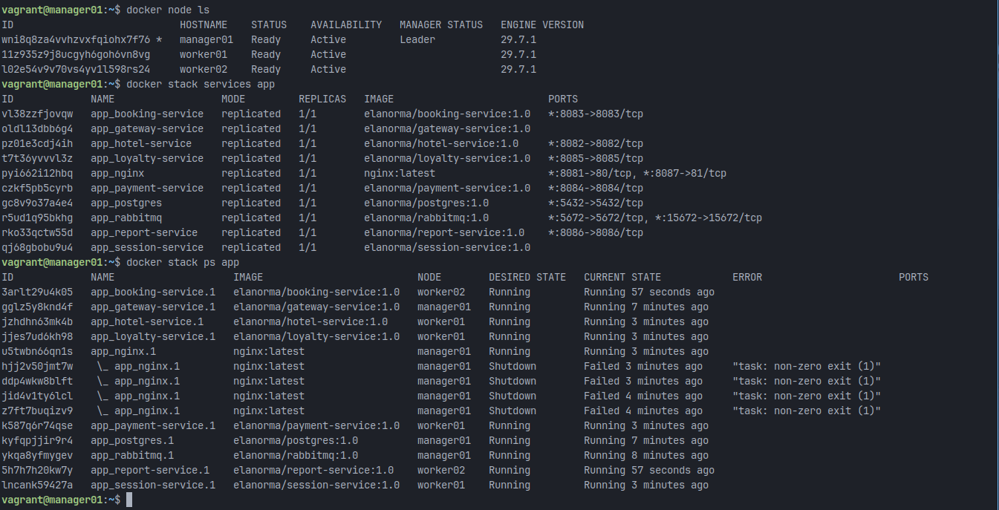

- Настрой прокси на базе nginx для доступа к gateway service и session service по оверлейной сети. Сами gateway service и session service сделай недоступными напрямую.
```
server {
    listen 80;
    
    location / {
        proxy_pass http://session-service:8081;
    }
}

server {
    listen 81;
    
    location / {
        proxy_pass http://gateway-service:8087;
    }
}
```

- Прогони заготовленные тесты через Postman и удостоверься, что все они проходят успешно. В отчете отобрази результаты тестирования.


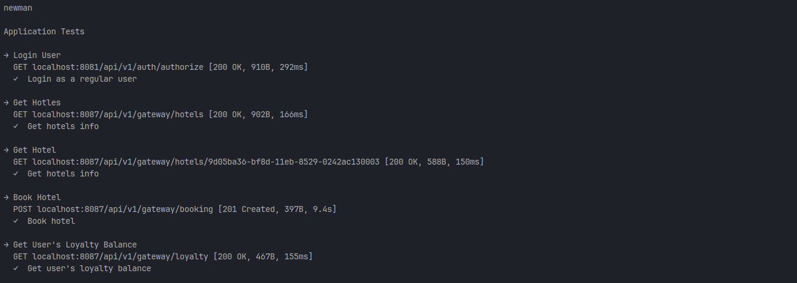
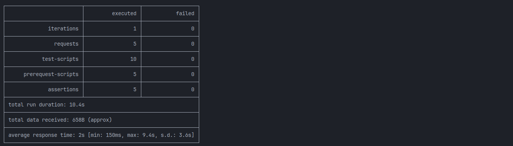

- Используя команды Docker, отобрази в отчете распределение контейнеров по узлам.

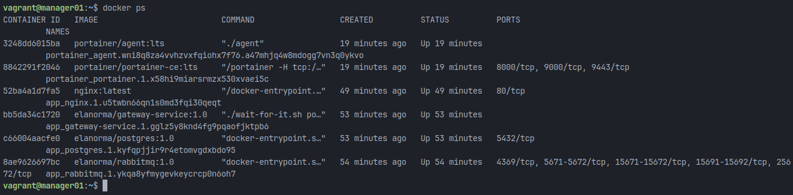
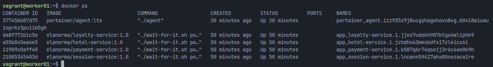
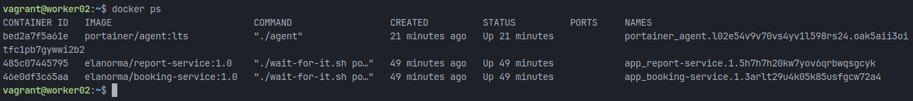

- Установи отдельным стеком Portainer внутри кластера. В отчете отобрази визуализацию распределения задач по узлам с помощью Portainer.


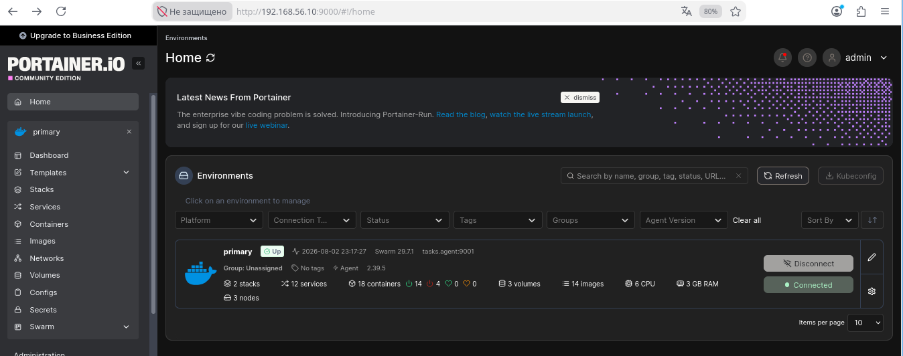
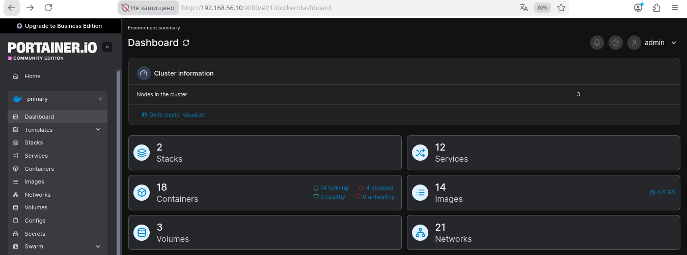
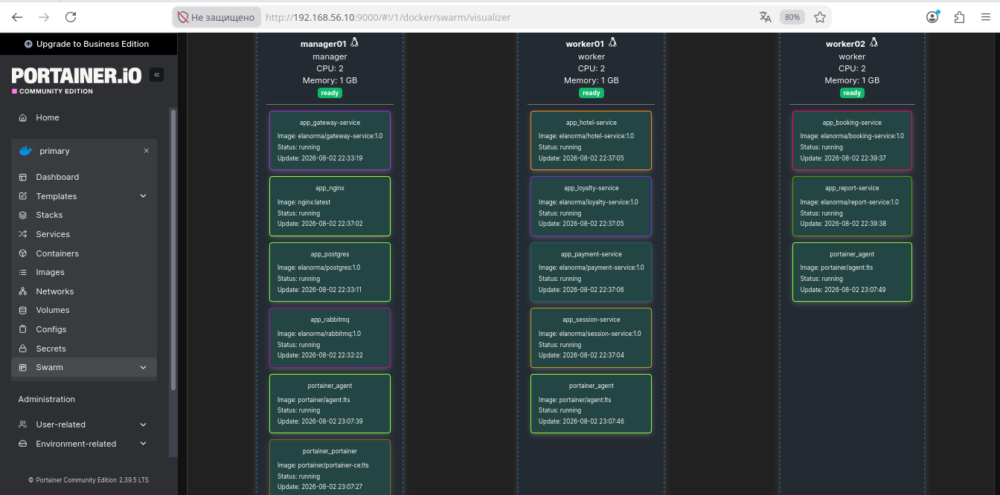