# DO6_CICD

## Part 1.Настройка gitlab-runner

- Поднимаем виртуальную машину Ubuntu Server 24.04 LTS.

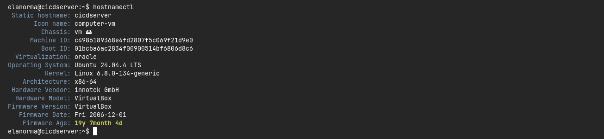

- Скачаваем и установливаем на виртуальную машину gitlab-runner.

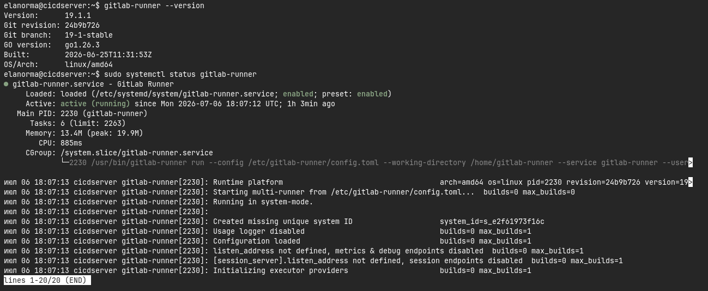

- Запускаем gitlab-runner и зарегистрируем его для использования в текущем проекте (DO6_CICD).

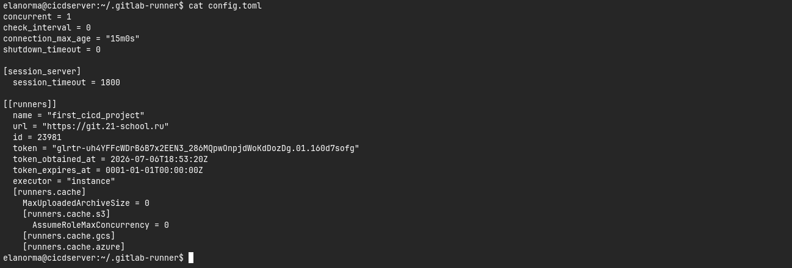
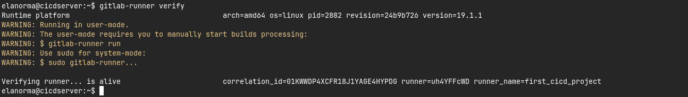

## Part 2.Сборка

- Пишем этап для CI по сборке приложения из папки code-samples DO.
- В файле .gitlab-ci.yml добавляем этап запуска сборки через мейк файл из папки code-samples.

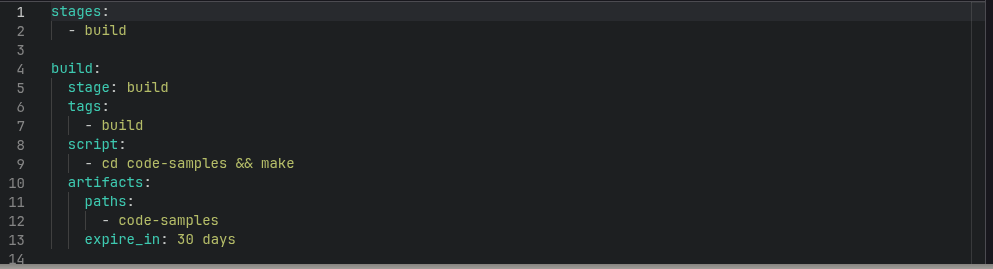
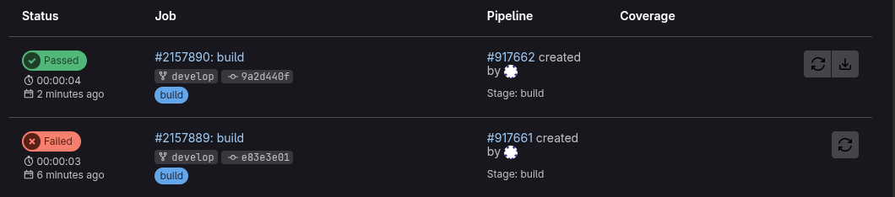
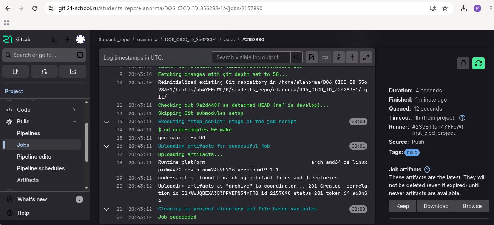

## Part 3.Тест кодстайла

- Пишем этап для CI, который запускает скрипт кодстайла (clang-format).

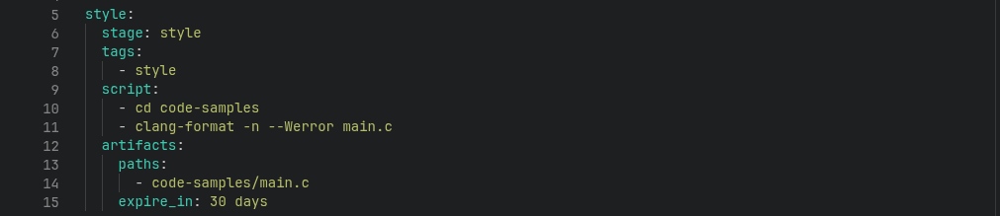

- Если кодстайл не прошел, то «зафейли» пайплайн.

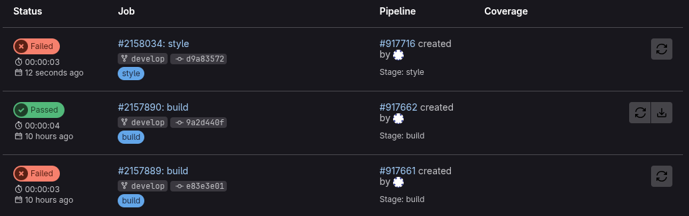
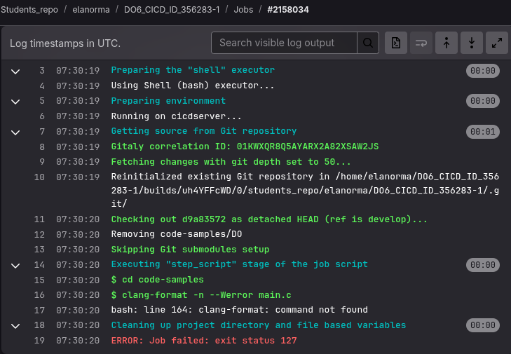
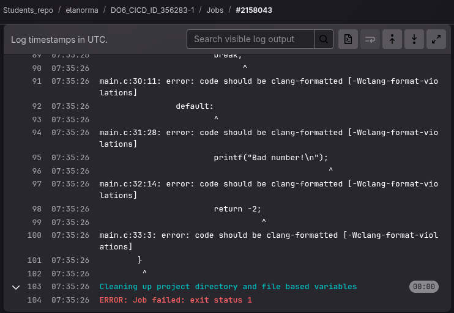

- В пайплайне отображаем вывод утилиты clang-format.

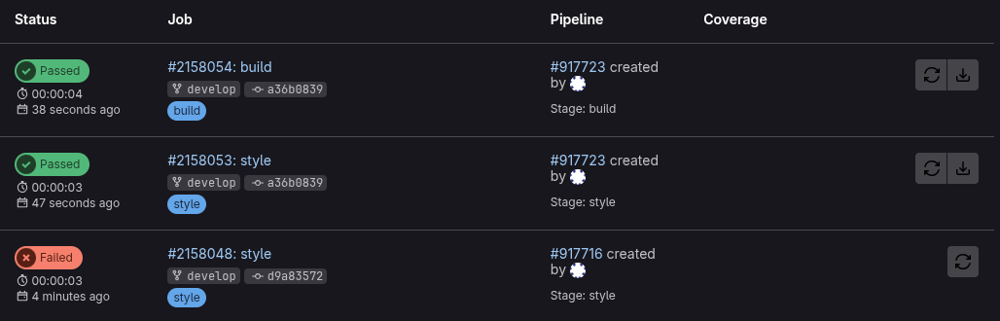
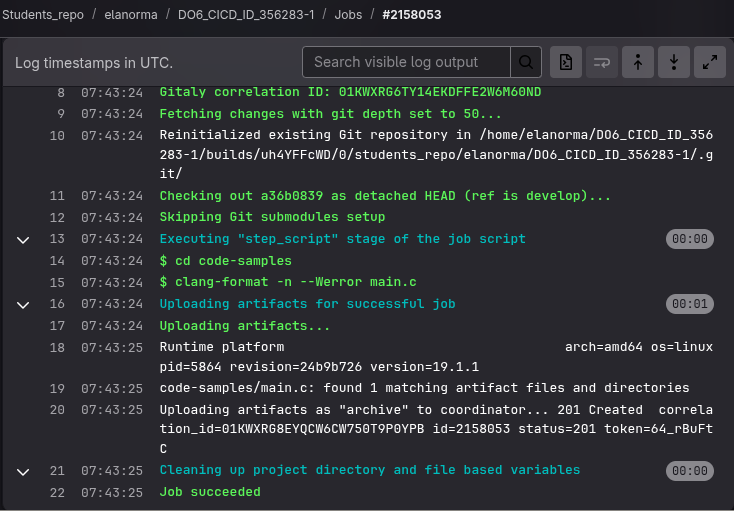

## Part 4.Интеграционные тесты

- Для проекта из папки code-samples пишем интеграционные тесты самостоятельно. Тесты могут быть написаны на любом языке (c, bash, python и т.д.) и должны вызывать собранное приложение для проверки его работоспособности на разных случаях.

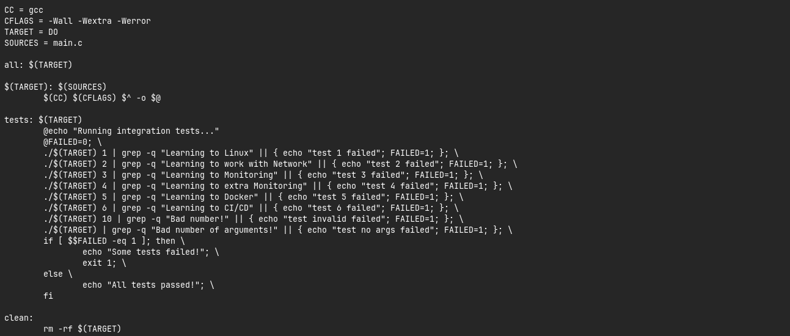

- Запускаем этот этап автоматически только при условии, если сборка и тест кодстайла прошли успешно.

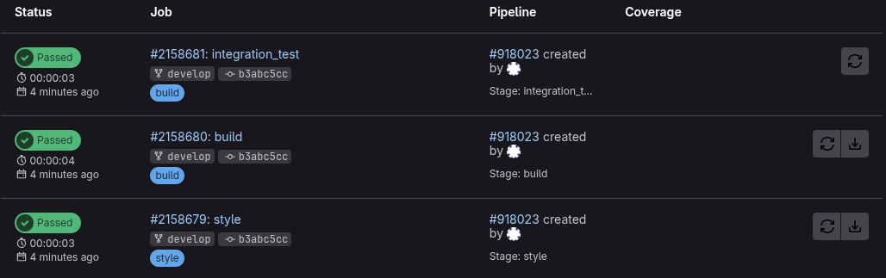
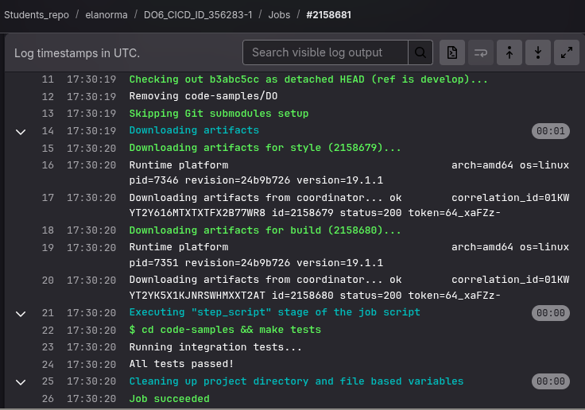

- Если тесты не прошли, то «зафейлим» пайплайн.
- В пайплайне отображаем вывод, что интеграционные тесты успешно прошли / провалились.

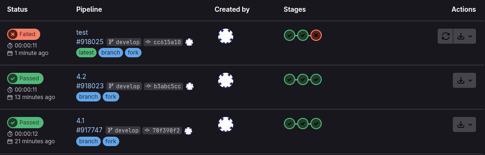
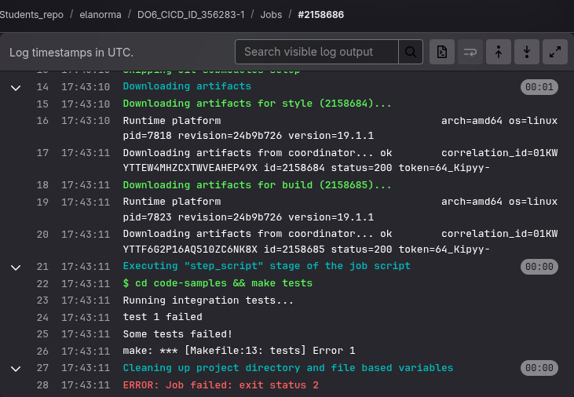

## Part 5.Этап деплоя

- Поднимаем вторую виртуальную машину Ubuntu Server 24.04 LTS.

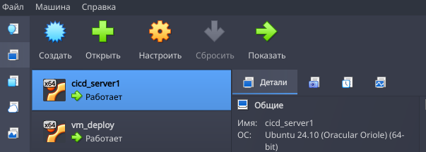
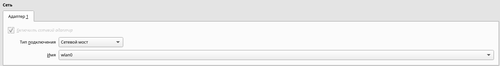
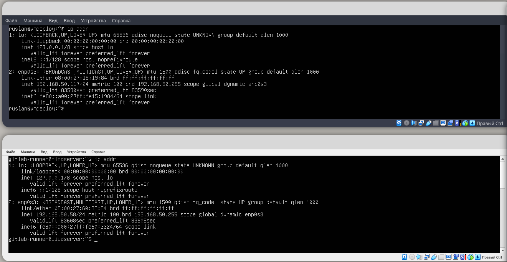
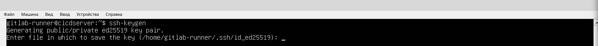
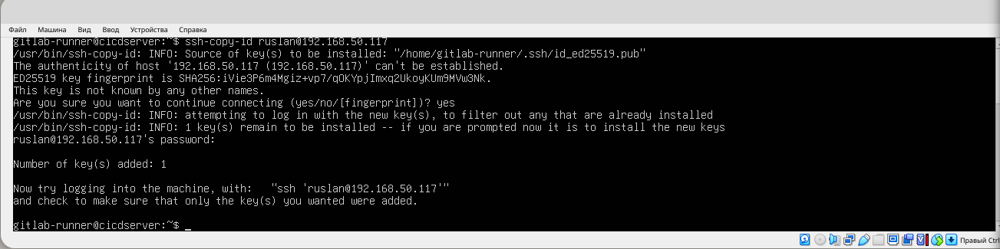
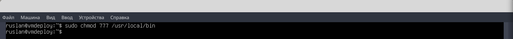

- Пишем этап для CD, который «разворачивает» проект на другой виртуальной машине.

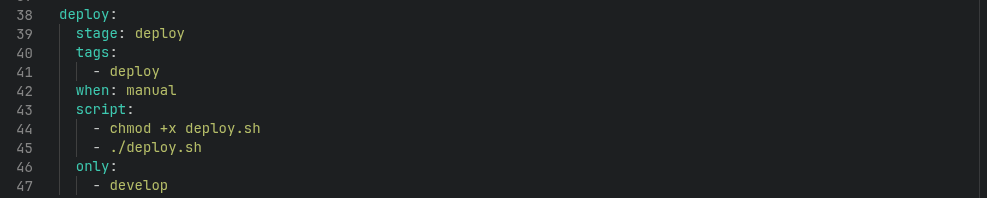

- Пишем bash-скрипт, который при помощи ssh и scp копирует файлы, полученные после сборки (артефакты), в директорию /usr/local/bin второй виртуальной машины

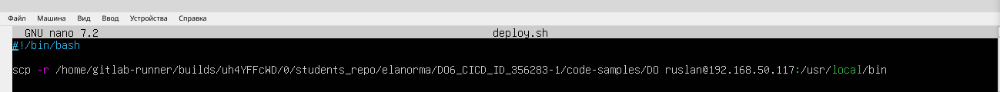

- Запускаем этот этап вручную при условии, что все предыдущие этапы прошли успешно.

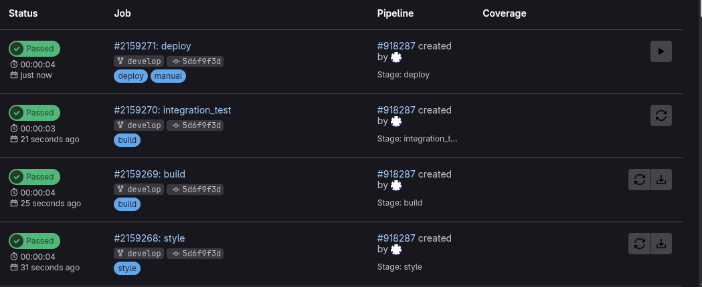
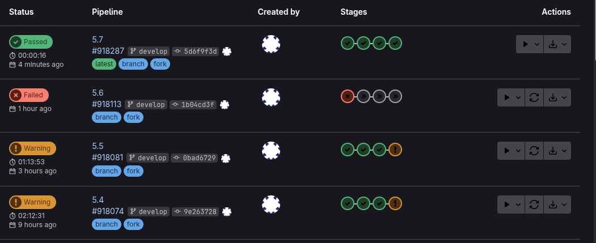
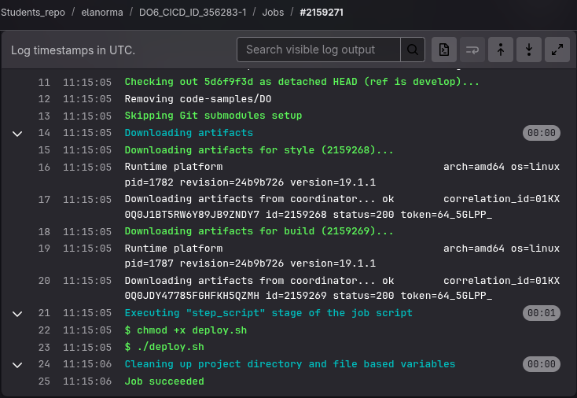

- В результате получаем готовое к работе приложение из папки code-samples (DO) на второй виртуальной машине.

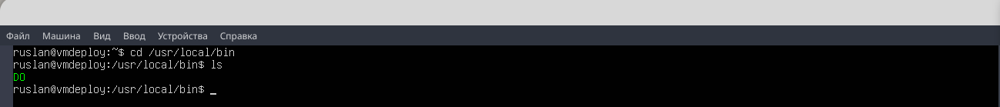